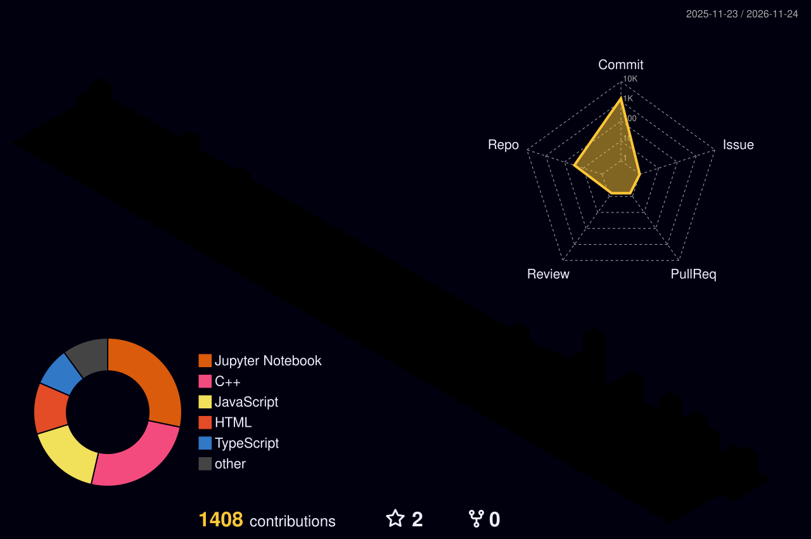

<div align="center">

<h3><code>pranjal@github ~ $ ./contributions.sh</code></h3>



<br><br>

<h3><code>pranjal@github ~ $ whoami</code></h3>

<table>
  <tr>
    <td valign="top"></td>
    <td valign="top"></td>
  </tr>
</table>

<br>


<br><br>

<a href="https://www.linkedin.com/in/pranjal-karan-5aa879284/"></a>
<a href="mailto:pranjalkaran2004@gmail.com"></a>
<a href="https://instagram.com/pranjal__karan"></a>

<br><br>


<br><br>

<code>
<a href="#about">./about</a> &nbsp;·&nbsp;
<a href="#projects">./projects</a> &nbsp;·&nbsp;
<a href="#stack">./stack</a> &nbsp;·&nbsp;
<a href="#snake">./snake</a> &nbsp;·&nbsp;
<a href="#contact">./contact</a>
</code>

</div>

<br>

---

<a id="about"></a>
<div align="center">

<h3><code>pranjal@github ~ $ cat about.md</code></h3>

</div>

```text
Full-stack engineer in the making, with a soft spot for healthcare and AI.

I build reliable systems and turn ideas into products people can actually use.
Currently shipping healthcare platforms, real-time systems, and LLM-powered tools.

education : B.Tech CSE (Health Informatics) - Class of 2027
status    : open to SDE internships 2026 / 2027
```

<table width="100%">
<tr>
<td width="25%" valign="top" align="center">
<h4><code>$ focus</code></h4>
<sub>
Full-Stack Engineering<br/><br/>
Backend Systems &amp; REST APIs<br/><br/>
AI/ML Applications<br/><br/>
Healthcare Technology
</sub>
</td>
<td width="25%" valign="top" align="center">
<h4><code>$ building</code></h4>
<sub>
Scalable apps with React, Next.js &amp; Node.js<br/><br/>
Healthcare platforms &amp; real-time systems<br/><br/>
AI products integrating LLMs &amp; ML
</sub>
</td>
<td width="25%" valign="top" align="center">
<h4><code>$ strengthening</code></h4>
<sub>
Data Structures &amp; Algorithms<br/><br/>
System Design &amp; Backend Architecture<br/><br/>
Applied Machine Learning
</sub>
</td>
<td width="25%" valign="top" align="center">
<h4><code>$ exploring</code></h4>
<sub>
Generative AI &amp; LLM apps<br/><br/>
RAG &amp; AI agents<br/><br/>
Distributed &amp; real-time systems
</sub>
</td>
</tr>
</table>

<div align="center">

<br>

> `$ fortune`
> *"Build reliable systems, solve meaningful problems, and turn ideas into products people can actually use."*

</div>

<details>
<summary><code>$ cat fun-facts.txt</code></summary>

<br/>

- 🎬 I get most of my inspiration from anime marathons
- 🧩 I enjoy untangling messy codebases as much as building new ones
- 🏥 I'm interested in the intersection of healthcare, AI, and software engineering
- ☕ Powered by late-night debugging sessions and coffee

</details>

<br>

---

<a id="projects"></a>
<div align="center">

<h3><code>pranjal@github ~ $ ls ./projects</code></h3>

<sub><code>6 items - from clinical platforms to real-time IoT and AI agents</code></sub>

</div>

<br/>

<table width="100%">

<!-- ROW 1 : titles -->
<tr>
<td width="33%" valign="top" align="center"><h3><code>healthpulse/</code></h3></td>
<td width="33%" valign="top" align="center"><h3><code>healconnect/</code></h3></td>
<td width="33%" valign="top" align="center"><h3><code>vibechat/</code></h3></td>
</tr>

<!-- ROW 1 : descriptions -->
<tr>
<td valign="top" align="center">
<em>Healthcare Appointment &amp; Clinical Platform</em>
<br/><br/>
<sub>
Conflict-free doctor scheduling, secure authentication, AI-assisted clinical summaries, and a scalable REST API architecture.
</sub>
</td>
<td valign="top" align="center">
<em>Real-Time IoT Health Monitoring</em>
<br/><br/>
<sub>
Patient sensors stream telemetry over MQTT through Mosquitto and an ingestion service into FastAPI, with live SSE updates on a Next.js dashboard.
</sub>
</td>
<td valign="top" align="center">
<em>Real-Time Messaging Platform</em>
<br/><br/>
<sub>
Persistent conversations, authenticated users, Socket.io communication, optimized MongoDB queries, and a responsive React UI.
</sub>
</td>
</tr>

<!-- ROW 1 : badges -->
<tr>
<td valign="top" align="center">


</td>
<td valign="top" align="center">


</td>
<td valign="top" align="center">


</td>
</tr>

<!-- ROW 1 : buttons -->
<tr>
<td valign="top" align="center">
<a href="https://www.health-pulse.app/"></a>
<a href="https://github.com/Pranjal-k22/Healthcare-app-manager"></a>
</td>
<td valign="top" align="center">
<!-- TODO: replace with the real HealConnect repo URL -->
<a href="https://github.com/Pranjal-k22"></a>
</td>
<td valign="top" align="center">
<!-- TODO: replace with the real VibeChat repo URL -->
<a href="https://github.com/Pranjal-k22"></a>
</td>
</tr>

<!-- ROW 2 : titles -->
<tr>
<td valign="top" align="center"><h3><code>astrosync/</code></h3></td>
<td valign="top" align="center"><h3><code>reconai/</code></h3></td>
<td valign="top" align="center"><h3><code>more-projects/</code></h3></td>
</tr>

<!-- ROW 2 : descriptions -->
<tr>
<td valign="top" align="center">
<em>AI Compatibility Analysis Platform</em>
<br/><br/>
<sub>
Algorithmic scoring modules combined with Gemini-powered serverless functions, multi-model fallback, and normalized conversation history.
</sub>
</td>
<td valign="top" align="center">
<em>AI Payment Monitoring &amp; Resolution</em>
<br/><br/>
<sub>
Monitors payment lifecycles, detects failed or incomplete transactions and reconciliation issues, and helps resolve them without manual back-and-forth with banks.
</sub>
</td>
<td valign="top" align="center">
<em>Experiments &amp; Side Builds</em>
<br/><br/>
<sub>
DSA practice, applied ML notebooks, and smaller experiments across web, AI, and healthcare tech.
</sub>
</td>
</tr>

<!-- ROW 2 : badges -->
<tr>
<td valign="top" align="center">


</td>
<td valign="top" align="center">


</td>
<td valign="top" align="center">


</td>
</tr>

<!-- ROW 2 : buttons -->
<tr>
<td valign="top" align="center">
<a href="https://astro-sync-liard.vercel.app/"></a>
<a href="https://github.com/Pranjal-k22/AstroSync"></a>
</td>
<td valign="top" align="center">
<!-- TODO: replace with the real ReconAI repo URL -->
<a href="https://github.com/Pranjal-k22"></a>
</td>
<td valign="top" align="center">
<a href="https://github.com/Pranjal-k22?tab=repositories"></a>
</td>
</tr>

</table>

<br>

---

<a id="stack"></a>
<div align="center">

<h3><code>pranjal@github ~ $ cat stack.txt</code></h3>

<code>languages</code>
<br><br>

&nbsp;&nbsp;
&nbsp;&nbsp;
&nbsp;&nbsp;
&nbsp;&nbsp;
&nbsp;&nbsp;


<br><br>

<code>frameworks &amp; libraries</code>
<br><br>

&nbsp;&nbsp;
&nbsp;&nbsp;
&nbsp;&nbsp;
&nbsp;&nbsp;
&nbsp;&nbsp;
&nbsp;&nbsp;
&nbsp;&nbsp;
&nbsp;&nbsp;


<br><br>

<code>databases, tools &amp; platforms</code>
<br><br>

&nbsp;&nbsp;
&nbsp;&nbsp;
&nbsp;&nbsp;
&nbsp;&nbsp;
&nbsp;&nbsp;


</div>

<br>

---

<a id="snake"></a>
<div align="center">

<h3><code>pranjal@github ~ $ ./snake.sh</code></h3>


<br><br>

<h3><code>pranjal@github ~ $ ./3d-contrib.sh</code></h3>



</div>

<br>

---

<a id="contact"></a>
<div align="center">

<h3><code>pranjal@github ~ $ mail -s "let's build something"</code></h3>

<code>I'm always up for interesting conversations, collaborations, and internship opportunities.</code>
<br>
<code>Drop a message - I reply fast.</code>

<br><br>

<a href="mailto:pranjalkaran2004@gmail.com"></a>
<a href="https://www.linkedin.com/in/pranjal-karan-5aa879284/"></a>

<br><br>


<sub>⭐ this repo if you liked the vibe.</sub>

</div>
