# The "Three Worlds" GitHub Profile README — Complete Architecture & Direction Guide

> **A masterclass in GitHub Profile Engineering**: High-end editorial aesthetic ("Paper & Ink" with vibrant world accents), 100% SVG-powered animated cards, zero-token unauthenticated live GitHub contribution scraping, and automated daily refresh via GitHub Actions.
> 
> *Note: This guide specifically removes the ASCII face photo processing and replaces it with a clean, modern, pure-code typographic and tech-terminal hero layout.*

---

## Table of Contents
1. [Architecture & Design Philosophy](#1-architecture--design-philosophy)
2. [Complete Project Folder Structure](#2-complete-project-folder-structure)
3. [Design System: Theme, Colors & Tokens](#3-design-system-theme-colors--tokens)
4. [Typography & Base64 Font Embedding](#4-typography--base64-font-embedding)
5. [Complete Animation Engine & Keyframes](#5-complete-animation-engine--keyframes)
6. [Layout & Mathematical SVG Spacing System](#6-layout--mathematical-svg-spacing-system)
7. [Complete Source Code for All Files](#7-complete-source-code-for-all-files)
   - [7.1 README.md](#71-readmemd)
   - [7.2 scripts/render_readme_cards.py](#72-scriptsrender_readme_cardspy)
   - [7.3 scripts/fetch_contributions.py](#73-scriptsfetch_contributionspy)
   - [7.4 .github/workflows/update-profile-art.yml](#74-githubworkflowsupdate-profile-artyml)
   - [7.5 scripts/requirements.txt](#75-scriptsrequirementstxt)
   - [7.6 fonts/README.md & Font Sourcing](#76-fontsreadmemd--font-sourcing)
8. [Step-by-Step Build & Deployment Guide](#8-step-by-step-build--deployment-guide)
9. [How to Customize for Your Personal Brand](#9-how-to-customize-for-your-personal-brand)

---

## 1. Architecture & Design Philosophy

GitHub profile READMEs are constrained by security rules:
- **No external JavaScript** can run.
- **No external CSS** `<link>` tags can be loaded.
- All external images are proxied through GitHub's `camo` CDN, stripping dynamic request parameters and caching aggressively.
- Markdown HTML lacks support for `display: grid` or `display: flex`.

### The Solution: Standalone Animated SVGs
Every section of the profile is rendered as a standalone **SVG** loaded through standard `` tags:
1. **Self-Contained Styling**: Pure CSS `@keyframes` and embedded `@font-face` (base64 WOFF) live directly inside `<style>` tags in each SVG.
2. **SMIL Animations**: SVG Native animations (`<animateTransform>` and `<set>`) power continuous metallic shine gradients and multi-frame number count-ups that run smoothly inside GitHub image tags.
3. **Zero-Token Public Scraping**: Contribution data is scraped directly from GitHub's unauthenticated public calendar fragment endpoint (`https://github.com/users/<username>/contributions`), calculating streaks, active days, and monthly totals without requiring any GitHub Personal Access Token or GraphQL quotas.
4. **Automated Daily Re-rendering**: A GitHub Action runs every morning on a cron schedule, fetches fresh contribution counts, re-generates all SVG cards, and pushes them back to `main` via `git-auto-commit-action`.

---

## 2. Complete Project Folder Structure

Below is the clean folder structure for your repository. Notice that all ASCII photo processing scripts (`prep_photo.py`, `make_ascii_svg.py`, `source-photo.png`, `avi-ascii.svg`) have been removed:

```
<your-username>/                  # GitHub Profile Repository (named exactly after your GitHub username)
├── .github/
│   └── workflows/
│       └── update-profile-art.yml # GitHub Action: Daily cron job to scrape & re-render SVGs
├── cards/                         # Output directory: Generated SVGs committed to git
│   ├── hero.svg                   # Full-width 880px Hero Card (Bio, Status, Live Stack)
│   ├── heatmap.svg                # Full-width 880px Custom Electric Blue Contribution Heatmap
│   ├── activity.svg               # Full-width 880px 12-Month Bar Chart & Streak Statistics
│   ├── build.svg                  # 1/3 Column Tile: Tech / Startups / Projects (Blue)
│   ├── brand.svg                  # 1/3 Column Tile: Audience / Social / Views (Red)
│   ├── learn.svg                  # 1/3 Column Tile: Blog / Education / Community (Yellow)
│   ├── title-coding-dark.svg      # Section Divider: "What I'm coding" (GitHub Dark Mode)
│   ├── title-coding-light.svg     # Section Divider: "What I'm coding" (GitHub Light Mode)
│   ├── repo-<repo1>.svg           # 1/3 Column Pinned Repository Card 1
│   ├── repo-<repo2>.svg           # 1/3 Column Pinned Repository Card 2
│   └── repo-<repo3>.svg           # 1/3 Column Pinned Repository Card 3
├── data/
│   └── contributions.json         # Cache of daily scraped contribution days & stats
├── fonts/                         # Subset WOFF font files embedded into SVGs as base64
│   ├── geist-400.woff             # Geist Regular (Body, blurbs, descriptions)
│   ├── geist-600.woff             # Geist Semi-Bold (Titles, repo headers)
│   ├── geistmono-400.woff         # Geist Mono (Labels, metrics, dates, stats)
│   ├── serif-400.woff             # Instrument Serif Regular (Display headers, numbers)
│   ├── serif-italic.woff          # Instrument Serif Italic (Shimmering name, emphasis)
│   └── README.md                  # License documentation for SIL Open Font License
├── scripts/
│   ├── fetch_contributions.py     # Public scraper for GitHub calendar + streak calculations
│   ├── render_readme_cards.py     # Master Python script that generates all SVG cards in cards/
│   └── requirements.txt           # Python dependencies (requests, beautifulsoup4)
├── README.md                      # The public GitHub Profile README
└── code&direction.md              # Complete documentation and setup manual (this file)
```

---

## 3. Design System: Theme, Colors & Tokens

The aesthetic is named **"Three Worlds"**, inspired by luxury editorial print design (Stripe Press, Monocle, The New Yorker) married to modern software aesthetics (Vercel, Linear).

### 3.1 Primary Paper & Ink Tokens
| Token | Hex Value | Semantic Role |
| :--- | :--- | :--- |
| `PAPER` | `#f3f3f1` | Warm, tactile off-white matte paper background for all cards |
| `PAPER_DEEP`| `#e2e2de` | Slightly recessed background; empty heatmap cells, subtle containers |
| `INK` | `#111111` | Deep pitch black for headlines, major figures, and primary text |
| `INK_SOFT` | `#3a3a3c` | Softer charcoal for multi-line body paragraphs and blurb descriptions |
| `MUTED` | `#6e6e73` | Apple-style secondary neutral for uppercase tags, axis labels, subtext |
| `RULE` | `#dcdcd7` | Hairline 1px border dividers separating stats and cards |

### 3.2 The "Three Worlds" Accent Palette
Every pillar of your personal developer identity is represented by a dedicated primary color:
| Pillar | Token | Hex Value | Meaning / Usage | Text On Top |
| :--- | :--- | :--- | :--- | :--- |
| **BUILD** | `TECH` | `#2f55ff` | Royal Electric Blue: Engineering, startups, open source | `#ffffff` |
| **BRAND** | `STUDIO` | `#ef3b2d` | Bold Poppy Red: Content creation, views, media, podcasts | `#ffffff` |
| **LEARN** | `LEARN` | `#ffc81a` | Saffron Gold Yellow: Mentorship, articles, tutorials, readers | `#111111` |

### 3.3 The Signature Blue Contribution Heatmap Ramp
Instead of GitHub's generic green squares, the heatmap uses an electric blue spectrum that glows over the warm paper background:
| Level | Contributions Range | Hex Color | Description |
| :---: | :--- | :--- | :--- |
| **0** | 0 contributions | `#e2e2de` | Paper Deep (subtle inactive cell) |
| **1** | 1 – 5 contributions | `#c8d3ff` | Soft periwinkle tint |
| **2** | 6 – 15 contributions | `#94a8ff` | Medium cobalt tint |
| **3** | 16 – 30 contributions| `#6280ff` | Bright electric blue |
| **4** | 31 – 50 contributions| `#2f55ff` | Signature Tech Blue |
| **5** | 50+ contributions | `#1a3be0` | Deep ultramarine powerhouse |

### 3.4 Dark & Light Mode Theme Adaptability
GitHub READMEs can switch graphics according to the viewer's OS/browser theme using HTML `<picture>`:
```html
<picture>
  <source media="(prefers-color-scheme: dark)" srcset="./cards/title-coding-dark.svg" />
  
</picture>
```
- In Dark Mode, the section title renders in crisp `#e6edf3`.
- In Light Mode, the section title renders in `#111111`.

---

## 4. Typography & Base64 Font Embedding

Because GitHub serves SVG images through an isolated image sandbox, external `@import url('https://fonts.googleapis.com/...')` is blocked. 

To achieve typography, **subset WOFF files** (containing ASCII characters and common arrows/symbols) are converted directly into **base64 data URIs** and injected into the `<style>` block of each SVG:

```python
@font-face {
  font-family: 'Instrument Serif';
  font-style: normal;
  font-weight: 400;
  src: url(data:font/woff;base64,d09GRgABAAAA...) format('woff');
}
```

### The Three Font Families
1. **Instrument Serif** (`serif-400.woff`, `serif-italic.woff`):
   - High-contrast, editorial serif font.
   - Used for big headline names (e.g. `font-size="116"`), hero statements, section headings, and large stat numbers.
   - Italic variant (`<tspan font-style="italic">`) adds a bespoke luxury publication touch.
2. **Geist** (`geist-400.woff`, `geist-600.woff`):
   - Designed by Vercel for modern software interfaces.
   - Used for bio body lines, repo titles, blurb sentences, and descriptions.
3. **Geist Mono** (`geistmono-400.woff`):
   - Technical monospace typography.
   - Used for category tags (`FULLSTACK ENGINEER`, `REFRESHED DAILY`), dates, streaks, axis labels, and code pills.

---

## 5. Complete Animation Engine & Keyframes

Every card includes pure CSS `@keyframes` and SMIL declarations. These trigger immediately on page load inside GitHub.

### 5.1 CSS Keyframe Definitions
```css
/* 1. rise: upward reveal with high-precision cubic-bezier */
@keyframes rise {
  from { opacity: 0; transform: translateY(16px); }
  to   { opacity: 1; transform: none; }
}

/* 2. fade: smooth optical opacity fade */
@keyframes fade {
  from { opacity: 0; }
  to   { opacity: 1; }
}

/* 3. grow: vertical growth from baseline (used for monthly activity bars) */
@keyframes grow {
  from { transform: scaleY(0); }
  to   { transform: scaleY(1); }
}

/* 4. pop: elastic bouncy scale-in (used for heatmap squares & peak badges) */
@keyframes pop {
  0%   { opacity: 0; transform: scale(.3); }
  70%  { opacity: 1; transform: scale(1.15); }
  100% { opacity: 1; transform: none; }
}

/* 5. pulse: continuous breathing beacon (used for the live status badge) */
@keyframes pulse {
  0%, 100% { opacity: 1; }
  50%      { opacity: .25; }
}

/* 6. nudge & nudgeup: subtle directional prompt arrows */
@keyframes nudge {
  0%, 100% { transform: none; }
  50%      { transform: translateX(4px); }
}
@keyframes nudgeup {
  0%, 100% { transform: none; }
  50%      { transform: translate(3px, -3px); }
}

/* 7. tilein: dramatic 3D-angled entrance for the 3 world tiles */
@keyframes tilein {
  0%   { opacity: 0; transform: translateY(90px) scale(.6) rotate(-9deg); }
  55%  { opacity: 1; transform: translateY(-10px) scale(1.05) rotate(2deg); }
  75%  { transform: translateY(3px) scale(.98) rotate(-.8deg); }
  90%  { transform: translateY(-1px) scale(1.01) rotate(.2deg); }
  100% { opacity: 1; transform: none; }
}

/* 8. slidein & arrowin: lateral entrance for headers and icons */
@keyframes slidein {
  from { opacity: 0; transform: translateX(-26px); }
  to   { opacity: 1; transform: none; }
}
@keyframes arrowin {
  0%   { opacity: 0; transform: translateX(-30px); }
  60%  { opacity: 1; transform: translateX(6px); }
  100% { opacity: 1; transform: none; }
}

/* 9. roll: slot-machine number roll */
@keyframes roll {
  from { transform: translateY(60px); }
  to   { transform: none; }
}

/* 10. sheen: glossy light reflection traversing cards every 5s */
@keyframes sheen {
  0%         { transform: translateX(-260px) skewX(-20deg); }
  22%, 100%  { transform: translateX(420px) skewX(-20deg); }
}

/* 11. ring: expanding radar ripple radiating outward */
@keyframes ring {
  0%   { opacity: .7; transform: scale(.2); }
  100% { opacity: 0; transform: scale(2.4); }
}
```

### 5.2 SMIL Infinite Gradient Shine
In the Hero Card, the user's surname has an infinite metallic light sweep powered by SVG SMIL:
```xml
<defs>
  <linearGradient id="shine" gradientUnits="userSpaceOnUse" x1="0" y1="0" x2="600" y2="0">
    <stop offset="0" stop-color="#111111"/>
    <stop offset=".42" stop-color="#111111"/>
    <stop offset=".5" stop-color="#2f55ff"/>
    <stop offset=".58" stop-color="#111111"/>
    <stop offset="1" stop-color="#111111"/>
    <animateTransform attributeName="gradientTransform" type="translate"
      values="-600 0;600 0;600 0" keyTimes="0;.45;1" dur="7s" begin="1.6s" repeatCount="indefinite"/>
  </linearGradient>
</defs>
<text fill="url(#shine)">Vashishta</text>
```

### 5.3 SMIL Number Count-Up Engine
Because JavaScript is forbidden, counting numbers (e.g. from `0` to `12.7M`) are created by rendering **18 discrete `<text>` frames** in Python with cubic ease-out calculation:
$$e = 1 - (1 - \frac{i}{N})^3$$
Each frame opacity is toggled using `<set attributeName="opacity" to="1" begin="..."/>` and `<set attributeName="opacity" to="0" begin="..."/>`. The number rolls upwards smoothly without a single line of JS.

### 5.4 Reduced Motion Accessibility
All animations honor user operating system preferences:
```css
@media (prefers-reduced-motion: reduce) {
  .r, .f, .g, .p, .live, .n, .nu, .ti, .sl, .ai, .ro, .rg {
    animation: none !important;
    opacity: 1 !important;
    transform: none !important;
  }
  .sh, .rg { display: none; }
}
```

---

## 6. Layout & Mathematical SVG Spacing System

GitHub markdown renders images inline. If you put standard spaces or line breaks between images:
```html
<!-- WRONG: Will wrap awkwardly or produce uneven 4px-8px whitespace -->



```
GitHub treats line breaks as space characters (`&#32;`), causing the 3 cards to overflow the line and wrap into an ugly 2-row layout.

### The Zero-Whitespace Rule
To make 3 columns fit side-by-side at 33.333% width each, they **must be concatenated on a single line with zero whitespace**:
```html
<!-- CORRECT: Exactly 1 row of 3 cards -->
<a href="..."></a><a href="..."></a><a href="..."></a><br>
```

### Mathematical Baked-In Gaps
Because HTML cannot apply CSS `gap: 12px` to markdown images, the 12px spacing is **mathematically baked directly into the SVG viewBox**:
- Full column width $W = 880\text{ px}$.
- Column width per tile: $\frac{880}{3} = 293.333\text{ px}$.
- Desired gap between tiles: $12\text{ px}$ (two gaps across three tiles $= 24\text{ px}$).
- Actual card visual width: $293.333 - 8 = 285.333\text{ px}$.

Each tile SVG has a transparent canvas width of $293.333\text{ px}$, but shifts the drawn rectangle using `left` and `right` transparent padding:
- **Tile 0 (Left tile)**: `left = 0`, `right = 8`. Visual card hugs the left border.
- **Tile 1 (Center tile)**: `left = 4`, `right = 4`. Visual card is centered.
- **Tile 2 (Right tile)**: `left = 8`, `right = 0`. Visual card hugs the right border.

$$\text{Gap between Tile 0 and 1} = 8\text{ px (right of Tile 0)} + 4\text{ px (left of Tile 1)} = 12\text{ px}$$
$$\text{Gap between Tile 1 and 2} = 4\text{ px (right of Tile 1)} + 8\text{ px (left of Tile 2)} = 12\text{ px}$$

The outer edges align flush with the 880px container, and the internal gaps are guaranteed to be 12px across all screen sizes.

---

## 7. Complete Source Code for All Files

### 7.1 `README.md`
Save this as `README.md` in the root of your profile repository:

```markdown
<!-- Every card is an animated SVG drawn by scripts/render_readme_cards.py and refreshed daily
     by .github/workflows/update-profile-art.yml. Design: "Three Worlds".
     Spacing is baked into the SVGs, so keep this block free of blank lines and keep the cards in
     a row on one line with no spaces between them. -->
<div align="center">
<a href="https://yourwebsite.com"></a><br>
<br>
<br>
<a href="https://yourwebsite.com/projects"></a><a href="https://yourwebsite.com/brand"></a><a href="https://yourwebsite.com/blog"></a><br>
<picture><source media="(prefers-color-scheme: dark)" srcset="./cards/title-coding-dark.svg" /></picture><br>
<a href="https://github.com/your-username/repo-one"></a><a href="https://github.com/your-username/repo-two"></a><a href="https://github.com/your-username/repo-three"></a>
</div>

<p align="center">
<a href="https://yourwebsite.com">yourwebsite.com</a> &nbsp;/&nbsp; <a href="https://linkedin.com/in/yourprofile">linkedin</a> &nbsp;/&nbsp; <a href="https://x.com/yourhandle">x / twitter</a> &nbsp;/&nbsp; <a href="mailto:you@yourdomain.com">email</a>
</p>
```

---

### 7.2 `scripts/render_readme_cards.py`
Save this as `scripts/render_readme_cards.py`. 

*(Notice: In this version, the Hero card has been redesigned into a pure code & typographic editorial hero with an animated tech terminal and live focus pills — completely eliminating the ASCII photo dependency while preserving every animation, token, font, and card!)*

```python
#!/usr/bin/env python3
"""
Render the profile README's cards as animated SVGs into cards/.

Design: "Three Worlds" (paper, ink, and one colour per world:
BUILD blue, BRAND red, LEARN yellow; Instrument Serif, Geist, Geist Mono).

Every card is a standalone SVG shown through , so it can only use what GitHub
allows there: inline CSS animations, SMIL and fonts embedded as data URIs (no JS,
no external requests). Fonts are subset WOFFs in fonts/ (SIL OFL).

Live numbers come from data/contributions.json (fetch_contributions.py).
Run by .github/workflows/update-profile-art.yml after fetch_contributions.py.
"""
import base64
import datetime
import json
import os
import re
from html import escape

HERE = os.path.dirname(os.path.abspath(__file__))
ROOT = os.path.join(HERE, "..")
DATA = os.path.join(ROOT, "data", "contributions.json")
OUT = os.path.join(ROOT, "cards")
FONTS = os.path.join(ROOT, "fonts")

# ---- Personalization Tokens (Customize with your own info) ------------------
FIRST_NAME = "Avi"
LAST_NAME = "Vashishta"
ROLE_BADGE = "FULLSTACK ENGINEER & AI BUILDER"
TAGLINE_LINES = [
    "I build high-scale AI products, make tech content,",
    "and teach developers to build modern software."
]
WEBSITE_DISPLAY = "avivashishta.com"

# World Metrics
BUILD_NUMBER = "3"
BUILD_LABEL = "startups"
BUILD_DESC = "Dock today. Before that Raycaster and AccioJob (YC), and Turgon AI."

BRAND_NUMBER = "12.7M"
BRAND_LABEL = "views"
BRAND_DESC = "Six months of tech videos across Instagram Reels, YouTube and X."

LEARN_NUMBER = "27.5K"
LEARN_LABEL = "readers"
LEARN_DESC = "Free resources for students and early-career devs, read this year."

# Pinned Repositories: (repo_slug, description, language, accent_color)
REPOS = [
    ("website-to-code", "Cool websites rebuilt as code you can use, one interaction per episode.", "TypeScript", "#2f55ff"),
    ("india-protest-map", "A live map of protests across India, built from GDELT news every 30 minutes.", "HTML", "#ef3b2d"),
    ("learning-agent", "Turns a PDF into a guided lesson: an AI agent plans it, quizzes you and reports back.", "TypeScript", "#ffc81a"),
]

# ---- Brand Tokens -----------------------------------------------------------
PAPER = "#f3f3f1"
PAPER_DEEP = "#e2e2de"
INK = "#111111"
INK_SOFT = "#3a3a3c"
MUTED = "#6e6e73"
RULE = "#dcdcd7"
TECH = "#2f55ff"      # BUILD Blue
STUDIO = "#ef3b2d"    # BRAND Red
LEARN_COLOR = "#ffc81a" # LEARN Yellow
W = 880               # Full card width (GitHub's README max column width)

SERIF = "'Instrument Serif', Georgia, serif"
SANS = "Geist, system-ui, -apple-system, sans-serif"
MONO = "'Geist Mono', ui-monospace, SFMono-Regular, Menlo, monospace"

FONT_FILES = {
    "serif": ("Instrument Serif", "normal", 400, "serif-400.woff"),
    "serif-i": ("Instrument Serif", "italic", 400, "serif-italic.woff"),
    "sans": ("Geist", "normal", 400, "geist-400.woff"),
    "sans-b": ("Geist", "normal", 600, "geist-600.woff"),
    "mono": ("Geist Mono", "normal", 400, "geistmono-400.woff"),
}

BASE_CSS = """
@keyframes rise{from{opacity:0;transform:translateY(16px)}to{opacity:1;transform:none}}
@keyframes fade{from{opacity:0}to{opacity:1}}
@keyframes grow{from{transform:scaleY(0)}to{transform:scaleY(1)}}
@keyframes pop{0%{opacity:0;transform:scale(.3)}70%{opacity:1;transform:scale(1.15)}100%{opacity:1;transform:none}}
@keyframes pulse{0%,100%{opacity:1}50%{opacity:.25}}
@keyframes nudge{0%,100%{transform:none}50%{transform:translateX(4px)}}
@keyframes nudgeup{0%,100%{transform:none}50%{transform:translate(3px,-3px)}}
.r{opacity:0;animation:rise .8s cubic-bezier(.2,.7,.2,1) both;transform-box:fill-box}
.f{opacity:0;animation:fade .9s ease-out both}
.g{transform-box:fill-box;transform-origin:bottom;transform:scaleY(0);animation:grow .8s cubic-bezier(.2,.7,.2,1) both}
.p{opacity:0;transform-box:fill-box;transform-origin:center;animation:pop .4s ease-out both}
.live{animation:pulse 1.6s ease-in-out infinite}
.n{transform-box:fill-box;animation:nudge 1.8s ease-in-out infinite}
.nu{transform-box:fill-box;animation:nudgeup 1.8s ease-in-out infinite}
@keyframes tilein{0%{opacity:0;transform:translateY(90px) scale(.6) rotate(-9deg)}55%{opacity:1;transform:translateY(-10px) scale(1.05) rotate(2deg)}75%{transform:translateY(3px) scale(.98) rotate(-.8deg)}90%{transform:translateY(-1px) scale(1.01) rotate(.2deg)}100%{opacity:1;transform:none}}
@keyframes slidein{from{opacity:0;transform:translateX(-26px)}to{opacity:1;transform:none}}
@keyframes arrowin{0%{opacity:0;transform:translateX(-30px)}60%{opacity:1;transform:translateX(6px)}100%{opacity:1;transform:none}}
@keyframes roll{from{transform:translateY(60px)}to{transform:none}}
@keyframes sheen{0%{transform:translateX(-260px) skewX(-20deg)}22%,100%{transform:translateX(420px) skewX(-20deg)}}
@keyframes ring{0%{opacity:.7;transform:scale(.2)}100%{opacity:0;transform:scale(2.4)}}
.ti{opacity:0;transform-box:fill-box;transform-origin:50% 60%;animation:tilein 1.1s cubic-bezier(.2,.8,.2,1) both}
.sl{opacity:0;transform-box:fill-box;animation:slidein .6s cubic-bezier(.2,.7,.2,1) both}
.ai{opacity:0;transform-box:fill-box;animation:arrowin .7s cubic-bezier(.2,.7,.2,1) both}
.ro{transform-box:fill-box;animation:roll .8s cubic-bezier(.15,.8,.2,1) both}
.sh{animation:sheen 5s ease-in-out infinite}
.rg{opacity:0;transform-box:fill-box;transform-origin:center;animation:ring 1s ease-out both}
@media (prefers-reduced-motion: reduce){.r,.f,.g,.p,.live,.n,.nu,.ti,.sl,.ai,.ro,.rg{animation:none!important;opacity:1!important;transform:none!important}.sh,.rg{display:none}}
"""


def font_face(keys):
    """Embed requested subset WOFF font files as base64 data URIs."""
    out = []
    for k in keys:
        fam, style, weight, fn = FONT_FILES[k]
        font_path = os.path.join(FONTS, fn)
        if os.path.exists(font_path):
            b64 = base64.b64encode(open(font_path, "rb").read()).decode()
            out.append(
                f"@font-face{{font-family:'{fam}';font-style:{style};font-weight:{weight};"
                f"src:url(data:font/woff;base64,{b64}) format('woff')}}"
            )
    return "".join(out)


GAP = 12          # 12px gap between cards
BOTTOM = 12       # 12px bottom padding
COL = W / 3       # Each column in a row of three is 293.333px


def svg(w, h, body, fonts, label, extra_css="", left=0, right=0, bottom=BOTTOM):
    """Draw a card with dimensions (w x h) inside a padded viewport for perfect grid tiling."""
    if left:
        body = f'<g transform="translate({left:.3f} 0)">{body}</g>'
    w_total, h_total = w + left + right, h + bottom
    css = font_face(fonts) + BASE_CSS + extra_css
    if os.environ.get("STATIC"):
        css += ".r,.f,.g,.p,.live,.n,.nu,.ti,.sl,.ai,.ro{animation:none!important;opacity:1!important;transform:none!important}.sh,.rg{display:none}"
    return (
        f'<svg xmlns="http://www.w3.org/2000/svg" width="{w_total:.3f}" height="{h_total}" viewBox="0 0 {w_total:.3f} {h_total}" '
        f'role="img" aria-label="{escape(label)}"><title>{escape(label)}</title>'
        f"<style>{css}</style>{body}</svg>"
    )


def write(name, content):
    os.makedirs(OUT, exist_ok=True)
    path = os.path.join(OUT, name)
    with open(path, "w", encoding="utf-8") as f:
        f.write(content)
    print(f"wrote cards/{name} ({len(content) // 1024} KB)")


def d(s):
    return f'style="animation-delay:{s:.2f}s"'


def wrap(text, n):
    lines, line = [], ""
    for word in text.split():
        if line and len(line) + 1 + len(word) > n:
            lines.append(line)
            line = word
        else:
            line = f"{line} {word}".strip()
    return lines + [line] if line else lines


def text_lines(x, y, lines, lh, attrs):
    return "".join(
        f'<text x="{x}" y="{y + i * lh}" {attrs}>{escape(l)}</text>' for i, l in enumerate(lines)
    )


# ---- 1 · Hero Card (Modern Typographic + Tech Terminal Layout) ---------------
def hero():
    h = 420
    body = f"""
<defs>
  <linearGradient id="shine" gradientUnits="userSpaceOnUse" x1="0" y1="0" x2="600" y2="0">
    <stop offset="0" stop-color="{INK}"/><stop offset=".42" stop-color="{INK}"/>
    <stop offset=".5" stop-color="{TECH}"/><stop offset=".58" stop-color="{INK}"/>
    <stop offset="1" stop-color="{INK}"/>
    <animateTransform attributeName="gradientTransform" type="translate" values="-600 0;600 0;600 0"
      keyTimes="0;.45;1" dur="7s" begin="1.6s" repeatCount="indefinite"/>
  </linearGradient>
</defs>
<rect width="{W}" height="{h}" rx="14" fill="{PAPER}"/>

<!-- Left Column: Editorial Headline & Bio -->
<g class="f" {d(0)}>
  <rect class="live" x="48" y="49" width="8" height="8" rx="2" fill="{TECH}"/>
  <text x="66" y="57" font-family="{MONO}" font-size="12" letter-spacing="1" fill="{MUTED}">{ROLE_BADGE}</text>
</g>
<text class="r" {d(0.15)} x="44" y="190" font-family="{SERIF}" font-size="116" letter-spacing="-2.5" fill="{INK}">{FIRST_NAME}</text>
<text class="r" {d(0.3)} x="44" y="290" font-family="{SERIF}" font-style="italic" font-size="116" letter-spacing="-2.5" fill="url(#shine)">{LAST_NAME}</text>
<g class="r" {d(0.55)}>
  {text_lines(48, 338, TAGLINE_LINES, 27, f'font-family="{SANS}" font-size="18" fill="{INK_SOFT}"')}
</g>
<g class="f" {d(0.8)}>
  <text x="48" y="396" font-family="{MONO}" font-size="13" fill="{INK}">{WEBSITE_DISPLAY}</text>
  <text class="nu" x="186" y="396" font-family="{MONO}" font-size="13" fill="{TECH}">&#8599;</text>
</g>

<!-- Right Column: Sleek Tech Terminal Box -->
<g class="r" {d(0.4)} transform="translate(510, 48)">
  <rect width="322" height="324" rx="12" fill="{PAPER_DEEP}" stroke="{RULE}" stroke-width="1"/>
  <!-- Terminal Title Bar -->
  <circle cx="20" cy="22" r="4.5" fill="#ff5f56"/>
  <circle cx="36" cy="22" r="4.5" fill="#ffbd2e"/>
  <circle cx="52" cy="22" r="4.5" fill="#27c93f"/>
  <text x="161" y="26" text-anchor="middle" font-family="{MONO}" font-size="11" fill="{MUTED}">profile.config.ts</text>
  <line x1="0" y1="42" x2="322" y2="42" stroke="{RULE}" stroke-width="1"/>

  <!-- Code Snippet -->
  <g font-family="{MONO}" font-size="12">
    <text x="20" y="74" fill="{MUTED}">const <tspan fill="{TECH}">developer</tspan> = &#123;</text>
    <text x="36" y="104" fill="{MUTED}">focus: <tspan fill="{INK}">"AI &amp; Fullstack"</tspan>,</text>
    <text x="36" y="134" fill="{MUTED}">stack: [<tspan fill="{STUDIO}">"Next.js"</tspan>, <tspan fill="{TECH}">"Python"</tspan>, <tspan fill="{INK}">"FastAPI"</tspan>],</text>
    <text x="36" y="164" fill="{MUTED}">status: <tspan fill="{TECH}">"Shipping daily"</tspan>,</text>
    <text x="36" y="194" fill="{MUTED}">location: <tspan fill="{INK}">"Remote / Global"</tspan></text>
    <text x="20" y="224" fill="{MUTED}">&#125;;</text>
  </g>

  <!-- Live Status Highlight Pill -->
  <g class="f" {d(0.9)} transform="translate(20, 252)">
    <rect width="282" height="48" rx="8" fill="{PAPER}" stroke="{RULE}" stroke-width="1"/>
    <circle class="live" cx="20" cy="24" r="4" fill="{TECH}"/>
    <text x="36" y="28" font-family="{MONO}" font-size="11" fill="{INK_SOFT}">Building the future of software</text>
  </g>
</g>
"""
    write("hero.svg", svg(W, h, body, ["serif", "serif-i", "sans", "mono"],
                          f"{FIRST_NAME} {LAST_NAME} - {ROLE_BADGE}"))


# ---- 2 · World Tiles (BUILD, BRAND, LEARN) -----------------------------------
TILE_W, TILE_H = 880 / 3 - 8, 210  # 285.33px card width, two 12px gaps across 880px


def count_up(num, word, x, y, attrs, begin, dur=1.1, frames=18):
    """Number counts up from 0 using SMIL <set> opacity toggles (runs in GitHub )."""
    m = re.match(r"([\d.]+)(.*)", num)
    val, suf = float(m.group(1)), m.group(2)
    dec = len(m.group(1).split(".")[1]) if "." in m.group(1) else 0
    tail = f' <tspan font-style="italic">{escape(word)}</tspan>'
    if os.environ.get("STATIC"):
        return f'<text x="{x}" y="{y}" {attrs}>{escape(num)}{tail}</text>'
    out = []
    for i in range(frames + 1):
        e = 1 - (1 - i / frames) ** 3
        txt = num if i == frames else f"{val * e:.{dec}f}{suf}"
        on = begin + dur * i / frames
        off = "" if i == frames else f'<set attributeName="opacity" to="0" begin="{begin + dur * (i + 1) / frames:.3f}s"/>'
        out.append(f'<text x="{x}" y="{y}" {attrs} opacity="0">{escape(txt)}{tail}'
                   f'<set attributeName="opacity" to="1" begin="{on:.3f}s"/>{off}</text>')
    return "".join(out)


def tile(name, label, color, on, num, word, blurb, delay, pos):
    lines = wrap(blurb, 34)
    blurb_svg = "".join(
        f'<text class="r" {d(delay + 0.75 + i * 0.1)} x="24" y="{150 + i * 20}" font-family="{SANS}" '
        f'font-size="14" fill="{on}" opacity=".92">{escape(l)}</text>'
        for i, l in enumerate(lines)
    )
    body = f"""
<defs>
  <clipPath id="card"><rect width="{TILE_W}" height="{TILE_H}" rx="14"/></clipPath>
  <clipPath id="slot"><rect x="0" y="62" width="{TILE_W}" height="62"/></clipPath>
  <linearGradient id="gl" x1="0" x2="1"><stop offset="0" stop-color="#fff" stop-opacity="0"/>
    <stop offset=".5" stop-color="#fff" stop-opacity=".35"/><stop offset="1" stop-color="#fff" stop-opacity="0"/></linearGradient>
</defs>
<g class="ti" {d(delay)}>
  <g clip-path="url(#card)">
    <rect width="{TILE_W}" height="{TILE_H}" fill="{color}"/>
    <circle class="rg" {d(delay + 0.5)} cx="{TILE_W - 40}" cy="{TILE_H - 40}" r="60" fill="none" stroke="{on}" stroke-opacity=".5" stroke-width="2"/>
    <rect class="sh" style="animation-delay:{delay + 1.4:.2f}s" x="0" y="-20" width="90" height="{TILE_H + 40}" fill="url(#gl)" transform="translate(-260 0)"/>
  </g>
  <text class="sl" {d(delay + 0.35)} x="24" y="38" font-family="{MONO}" font-size="12" letter-spacing="1.2" fill="{on}">{label}</text>
  <g class="ai" {d(delay + 0.5)}><text class="n" style="animation-delay:{delay + 1.3:.2f}s" x="250" y="38" font-family="{MONO}" font-size="14" fill="{on}">&#8594;</text></g>
  <g clip-path="url(#slot)"><g class="ro" {d(delay + 0.45)}>
    {count_up(num, word, 22, 112, f'font-family="{SERIF}" font-size="44" fill="{on}"', delay + 0.45)}
  </g></g>
  {blurb_svg}
</g>
"""
    write(f"{name}.svg", svg(TILE_W, TILE_H, body, ["serif", "serif-i", "sans", "mono"],
                             f"{label}: {num} {word}. {blurb}", left=4 * pos, right=8 - 4 * pos))


# ---- 3 · Activity Card (12 Monthly Bars + Streak Stats) ----------------------
def activity(data):
    h = 340
    monthly = data["monthly"][-12:]
    best = max(monthly[:-1] or monthly, key=lambda m: m["total"])
    top = best["total"]
    x0, x1, base, maxh, gap = 40, 600, 292, 140, 10
    bw = (x1 - x0 - gap * (len(monthly) - 1)) / len(monthly)
    bars = []
    for i, m in enumerate(monthly):
        partial = i == len(monthly) - 1
        is_best = m is best
        bh = max(4, round(m["total"] / top * maxh))
        x = x0 + i * (bw + gap)
        fill = TECH if is_best else ("#c9c9c4" if partial else INK)
        label = datetime.date.fromisoformat(m["month"] + "-01").strftime("%b")
        bars.append(
            f'<rect class="g" style="animation-delay:{2.2 + i * 0.07:.2f}s" x="{x:.1f}" y="{base - bh}" '
            f'width="{bw:.1f}" height="{bh}" rx="4" fill="{fill}"><title>{label}: {m["total"]:,}</title></rect>'
            f'<text class="f" style="animation-delay:{2.2 + i * 0.07:.2f}s" x="{x + bw / 2:.1f}" y="{base + 22}" '
            f'text-anchor="middle" font-family="{MONO}" font-size="11" fill="{MUTED}">{label}</text>'
        )
        if is_best:
            bars.append(
                f'<text class="p" style="animation-delay:3.2s" x="{x + bw / 2:.1f}" y="{base - bh - 10}" '
                f'text-anchor="middle" font-family="{MONO}" font-size="11" fill="{TECH}">{m["total"]:,}</text>'
            )
    cs = data["current_streak"]["length"]
    ls = data["longest_streak"]["length"]
    streak_note = "current streak, and the longest" if cs >= ls else f"current streak, longest {ls}"
    total_days = len(data["days"])
    stats = [
        (f'{cs} <tspan font-style="italic">days</tspan>', streak_note),
        (f'{data["active_days"]}<tspan fill="#8e8e93"> / {total_days}</tspan>', "days with a commit"),
        (f'{data["best_day"]["count"]}', "on the busiest day"),
    ]
    side = []
    for i, (big, small) in enumerate(stats):
        y = 104 + i * 92
        side.append(
            f'<g class="r" {d(2.6 + i * 0.15)}>'
            f'<text x="650" y="{y}" font-family="{SERIF}" font-size="40" fill="{INK}">{big}</text>'
            f'<text x="650" y="{y + 24}" font-family="{SANS}" font-size="13" fill="{MUTED}">{small}</text></g>'
        )
        if i < 2:
            side.append(f'<rect class="f" {d(2.6)} x="650" y="{y + 44}" width="190" height="1" fill="{RULE}"/>')
    body = f"""
<rect width="{W}" height="{h}" rx="14" fill="{PAPER}"/>
<text class="f" {d(1.9)} x="40" y="58" font-family="{MONO}" font-size="12" letter-spacing="1" fill="{MUTED}">THE LAST 12 MONTHS ON GITHUB</text>
<text class="r" {d(2.0)} x="38" y="114" font-family="{SERIF}" font-size="52" fill="{INK}">{data["total_contributions"]:,} <tspan font-style="italic">contributions</tspan></text>
{''.join(bars)}
{''.join(side)}
"""
    write("activity.svg", svg(W, h, body, ["serif", "serif-i", "sans", "mono"],
                              f'{data["total_contributions"]:,} contributions in the last year, {cs}-day streak'))


# ---- 4 · Pinned Repository Cards --------------------------------------------
REPO_W, REPO_H = 880 / 3 - 8, 176


def repo_card(i, name, desc, lang, color, stars):
    delay = 4.6 + i * 0.12
    meta = f"{lang}  ·  ★ {stars}" if stars else f"{lang}  ·  live"
    body = f"""
<rect width="{REPO_W}" height="{REPO_H}" rx="14" fill="{PAPER}"/>
<g class="r" {d(delay)}>
  <rect x="24" y="30" width="8" height="8" rx="2" fill="{color}"/>
  <text x="40" y="39" font-family="{SANS}" font-weight="600" font-size="18" fill="{INK}">{escape(name)}</text>
  {text_lines(24, 72, wrap(desc, 34), 21, f'font-family="{SANS}" font-size="14" fill="{INK_SOFT}"')}
  <text x="24" y="{REPO_H - 24}" font-family="{MONO}" font-size="12" fill="{MUTED}">{escape(meta)}</text>
</g>
"""
    write(f"repo-{name}.svg", svg(REPO_W, REPO_H, body, ["sans", "sans-b", "mono"], f"{name}: {desc}",
                                  left=4 * i, right=8 - 4 * i))


def section_title(text, italic, theme):
    fg = "#e6edf3" if theme == "dark" else INK
    body = (
        f'<text class="r" {d(4.4)} x="2" y="46" font-family="{SERIF}" font-size="34" fill="{fg}">{escape(text)} '
        f'<tspan font-style="italic">{escape(italic)}</tspan></text>'
    )
    write(f"title-coding-{theme}.svg", svg(W, 64, body, ["serif", "serif-i"], f"{text} {italic}", bottom=0))


# ---- 5 · Blue Contribution Heatmap ------------------------------------------
BLUE = [PAPER_DEEP, "#c8d3ff", "#94a8ff", "#6280ff", TECH, "#1a3be0"]


def level_for(c):
    return 0 if c == 0 else 1 if c <= 5 else 2 if c <= 15 else 3 if c <= 30 else 4 if c <= 50 else 5


def heatmap(data):
    days = data["days"]
    first = datetime.date.fromisoformat(days[0]["date"])
    lead = (first.weekday() + 1) % 7  # sunday = 0
    cell, step, gx, gy = 12, 15, 44, 96
    cells, months, seen = [], [], set()
    for i, day in enumerate(days):
        k = i + lead
        col, row = divmod(k, 7)
        date = datetime.date.fromisoformat(day["date"])
        if date.day <= 7 and (date.year, date.month) not in seen and row == 0:
            seen.add((date.year, date.month))
            months.append((col, date.strftime("%b")))
        c = day["count"]
        delay = 1.0 + col * 0.03 + row * 0.02
        cells.append(
            f'<rect class="p" style="animation-delay:{delay:.2f}s" x="{gx + col * step}" y="{gy + row * step}" '
            f'width="{cell}" height="{cell}" rx="3" fill="{BLUE[level_for(c)]}">'
            f'<title>{day["date"]}: {c} contribution{"s" if c != 1 else ""}</title></rect>'
        )
    ncols = (len(days) + lead + 6) // 7
    right = gx + ncols * step - 3
    labels = "".join(
        f'<text x="{gx + col * step}" y="{gy + 7 * step + 16}" font-family="{MONO}" font-size="11" fill="{MUTED}">{m}</text>'
        for col, m in months if col < ncols - 12
    )
    legend_x = right - len(BLUE) * 14
    legend = "".join(
        f'<rect x="{legend_x + i * 14}" y="{gy + 7 * step + 6}" width="11" height="11" rx="2.5" fill="{c}"/>'
        for i, c in enumerate(BLUE)
    )
    h = gy + 7 * step + 44
    body = f"""
<rect width="{W}" height="{h}" rx="14" fill="{PAPER}"/>
<text class="r" {d(0.8)} x="42" y="62" font-family="{SERIF}" font-size="34" fill="{INK}">Every day, <tspan font-style="italic" fill="{TECH}">in blue</tspan></text>
<text class="f" {d(0.8)} x="{right}" y="60" text-anchor="end" font-family="{MONO}" font-size="12" letter-spacing="1" fill="{MUTED}">REFRESHED DAILY</text>
{''.join(cells)}
<g class="f" {d(2.4)}>{labels}
<text x="{legend_x - 8}" y="{gy + 7 * step + 16}" text-anchor="end" font-family="{MONO}" font-size="11" fill="{MUTED}">less</text>
{legend}
<text x="{legend_x + len(BLUE) * 14 + 2}" y="{gy + 7 * step + 16}" font-family="{MONO}" font-size="11" fill="{MUTED}">more</text></g>
"""
    write("heatmap.svg", svg(W, h, body, ["serif", "serif-i", "mono"],
                             f'Contribution graph: {data["total_contributions"]:,} contributions in the last year'))


def repo_stars(username):
    """Fetch live star counts from GitHub REST API (gracefully fallback if offline)."""
    stars = {}
    try:
        import requests
        for name, *_ in REPOS:
            r = requests.get(f"https://api.github.com/repos/{username}/{name}", timeout=10)
            if r.ok:
                stars[name] = r.json().get("stargazers_count", 0)
    except Exception as e:
        print(f"stars API unavailable ({e}); proceeding with defaults")
    return stars


if __name__ == "__main__":
    if not os.path.exists(DATA):
        print(f"Data file not found at {DATA}. Run fetch_contributions.py first.")
        exit(1)
    data = json.load(open(DATA, encoding="utf-8"))
    username = data.get("username", "your-username")

    hero()
    tile("build", "BUILD", TECH, "#ffffff", BUILD_NUMBER, BUILD_LABEL, BUILD_DESC, 3.1, 0)
    tile("brand", "BRAND", STUDIO, "#ffffff", BRAND_NUMBER, BRAND_LABEL, BRAND_DESC, 3.35, 1)
    tile("learn", "LEARN", LEARN_COLOR, INK, LEARN_NUMBER, LEARN_LABEL, LEARN_DESC, 3.6, 2)
    activity(data)

    stars = repo_stars(username)
    for i, (name, desc, lang, color) in enumerate(REPOS):
        repo_card(i, name, desc, lang, color, stars.get(name, 0))

    section_title("What I'm", "coding", "dark")
    section_title("What I'm", "coding", "light")
    heatmap(data)
    print("All README cards successfully rendered into cards/")
```

---

### 7.3 `scripts/fetch_contributions.py`
Save this as `scripts/fetch_contributions.py`. It scrapes GitHub's public contribution calendar fragment with zero authentication and outputs complete statistics to `data/contributions.json`:

```python
#!/usr/bin/env python3
"""
Scrape real daily contribution counts from GitHub's public contributions endpoint
(the same HTML fragment the profile page uses) and write data/contributions.json
with the raw days plus derived stats (current streak, longest streak, best day, monthly totals).

No token, no auth, no GraphQL -- just the public HTML GitHub already serves.
Run daily by .github/workflows/update-profile-art.yml.
"""
import datetime
import json
import os
import re
import sys
import requests
from bs4 import BeautifulSoup

# Reads from environment variable GH_PROFILE_USER, or fallback to default
USERNAME = os.environ.get("GH_PROFILE_USER", "AVIVASHISHTA29")
URL = f"https://github.com/users/{USERNAME}/contributions"
OUT_PATH = os.path.join(os.path.dirname(__file__), "..", "data", "contributions.json")


def fetch_days():
    resp = requests.get(URL, headers={"User-Agent": "profile-readme-bot/1.0"}, timeout=30)
    resp.raise_for_status()
    soup = BeautifulSoup(resp.text, "html.parser")

    cells = soup.select("td.ContributionCalendar-day")
    if not cells:
        print("no calendar cells found -- github markup may have changed", file=sys.stderr)
        sys.exit(1)

    days = []
    for td in cells:
        date = td.get("data-date")
        if not date:
            continue
        td_id = td.get("id")
        tooltip_el = soup.find("tool-tip", attrs={"for": td_id}) if td_id else None
        text = tooltip_el.get_text(strip=True) if tooltip_el else ""
        if re.search(r"no contributions", text, re.I):
            count = 0
        else:
            m = re.match(r"(\d+)", text)
            count = int(m.group(1)) if m else 0
        days.append({"date": date, "count": count, "level": int(td.get("data-level") or 0)})

    days.sort(key=lambda d: d["date"])
    return days


def compute_current_streak(days):
    idx = len(days) - 1
    if days[idx]["count"] == 0:
        idx -= 1  # today isn't over yet -- don't break the streak on it
    streak = 0
    end_idx = idx
    while idx >= 0 and days[idx]["count"] > 0:
        streak += 1
        idx -= 1
    start_idx = idx + 1
    if streak == 0:
        return 0, None, None
    return streak, days[start_idx]["date"], days[end_idx]["date"]


def compute_longest_streak(days):
    longest = run = 0
    longest_start = longest_end = None
    run_start_idx = None
    for i, d in enumerate(days):
        if d["count"] > 0:
            if run == 0:
                run_start_idx = i
            run += 1
            if run > longest:
                longest = run
                longest_start = days[run_start_idx]["date"]
                longest_end = days[i]["date"]
        else:
            run = 0
    return longest, longest_start, longest_end


def build_data(days):
    total = sum(d["count"] for d in days)
    active_days = sum(1 for d in days if d["count"] > 0)
    best = max(days, key=lambda d: d["count"])
    cur_len, cur_start, cur_end = compute_current_streak(days)
    long_len, long_start, long_end = compute_longest_streak(days)

    monthly = {}
    for d in days:
        key = d["date"][:7]
        monthly[key] = monthly.get(key, 0) + d["count"]
    monthly_list = [{"month": k, "total": v} for k, v in sorted(monthly.items())]

    return {
        "username": USERNAME,
        "generated_at": datetime.datetime.utcnow().strftime("%Y-%m-%dT%H:%M:%SZ"),
        "range": {"start": days[0]["date"], "end": days[-1]["date"]},
        "total_contributions": total,
        "active_days": active_days,
        "avg_per_active_day": round(total / active_days, 1) if active_days else 0,
        "current_streak": {"length": cur_len, "start": cur_start, "end": cur_end},
        "longest_streak": {"length": long_len, "start": long_start, "end": long_end},
        "best_day": {"date": best["date"], "count": best["count"]},
        "monthly": monthly_list,
        "days": days,
    }


if __name__ == "__main__":
    days = fetch_days()
    data = build_data(days)
    os.makedirs(os.path.dirname(OUT_PATH), exist_ok=True)
    with open(OUT_PATH, "w", encoding="utf-8") as f:
        json.dump(data, f, indent=2)
    print(f"wrote {OUT_PATH}: {data['total_contributions']} contributions, "
          f"current streak {data['current_streak']['length']}, "
          f"longest streak {data['longest_streak']['length']}")
```

---

### 7.4 `.github/workflows/update-profile-art.yml`
Save this as `.github/workflows/update-profile-art.yml`:

```yaml
name: Update profile art

# Refreshes the contribution graph + cards SVGs daily from real GitHub data.
# Runs every day at 06:17 UTC, on push to main, and on-demand via workflow_dispatch.

"on":
  schedule:
    - cron: "17 6 * * *"   # 06:17 UTC daily
  workflow_dispatch: {}
  push:
    branches: [main]

permissions:
  contents: write

jobs:
  heatmap:
    runs-on: ubuntu-latest
    steps:
      - name: Checkout repository
        uses: actions/checkout@v4

      - name: Set up Python
        uses: actions/setup-python@v5
        with:
          python-version: "3.11"

      - name: Install dependencies
        run: pip install -r scripts/requirements.txt

      - name: Scrape real contribution data (no auth needed)
        env:
          GH_PROFILE_USER: ${{ github.repository_owner }}
        run: python scripts/fetch_contributions.py

      - name: Render README animated cards
        run: python scripts/render_readme_cards.py

      - name: Commit updated cards and data
        uses: stefanzweifel/git-auto-commit-action@v5
        with:
          commit_message: "chore: refresh profile art [skip ci]"
          file_pattern: "data/contributions.json cards/*.svg"
```

---

### 7.5 `scripts/requirements.txt`
Save this as `scripts/requirements.txt`:

```
requests>=2.31.0
beautifulsoup4>=4.12.0
```

---

### 7.6 `fonts/README.md` & Font Sourcing
Save this as `fonts/README.md`:

```markdown
Subset (printable ASCII plus common punctuation, arrows, and symbols) WOFF builds of:
- Instrument Serif (serif-400.woff, serif-italic.woff)
- Geist (geist-400.woff, geist-600.woff)
- Geist Mono (geistmono-400.woff)

Embedded into the profile cards by `scripts/render_readme_cards.py`.
All fonts are open-source and licensed under the SIL Open Font License 1.1 (https://openfontlicense.org).
```

> **How to get the fonts**:
> You can copy the 5 existing `.woff` files directly from `fonts/` in this repository! They are already stripped to under 18 KB each to maximize SVG loading speeds.

---

## 8. Step-by-Step Build & Deployment Guide

### Step 1: Create your Special Profile Repository
1. On GitHub, create a new public repository with the **exact same name as your GitHub username** (e.g. `github.com/johndoe/johndoe`).
2. Make sure it is marked **Public** and check **Add a README file**.

### Step 2: Initialize Directory Structure
In your local terminal:
```bash
git clone https://github.com/<your-username>/<your-username>.git
cd <your-username>

# Create folder structure
mkdir -p .github/workflows cards data fonts scripts
```

### Step 3: Copy the Files
1. Copy the 5 `.woff` font files into `fonts/`.
2. Copy `scripts/fetch_contributions.py`, `scripts/render_readme_cards.py`, and `scripts/requirements.txt` into `scripts/`.
3. Copy `.github/workflows/update-profile-art.yml` into `.github/workflows/`.
4. Copy `README.md` into the root.

### Step 4: Run Locally to Test
Run the two scripts in order:
```bash
pip install -r scripts/requirements.txt

# 1. Fetch live data
export GH_PROFILE_USER="<your-username>"
python scripts/fetch_contributions.py

# 2. Render all SVG cards
python scripts/render_readme_cards.py
```
Check the `cards/` directory: all 11 SVG cards (`hero.svg`, `heatmap.svg`, `activity.svg`, `build.svg`, etc.) will be generated. Open any of them in Google Chrome or Edge to see the animations play live!

### Step 5: Enable GitHub Action Workflow Write Permissions
1. In your GitHub repository, navigate to **Settings** > **Actions** > **General**.
2. Scroll down to **Workflow permissions**.
3. Select **"Read and write permissions"** and check **"Allow GitHub Actions to create and approve pull requests"**.
4. Click **Save**.

### Step 6: Commit and Push
```bash
git add .
git commit -m "feat: launch animated three worlds profile"
git push origin main
```
Visit your GitHub profile (`https://github.com/<your-username>`). Your profile will now render the animated Three Worlds cards, refreshed every morning automatically!

---

## 9. How to Customize for Your Personal Brand

| Goal | File to Edit | Lines / Variables |
| :--- | :--- | :--- |
| **Name & Bio** | `scripts/render_readme_cards.py` | Change `FIRST_NAME`, `LAST_NAME`, `ROLE_BADGE`, `TAGLINE_LINES`, `WEBSITE_DISPLAY` |
| **World Metrics** | `scripts/render_readme_cards.py` | Change `BUILD_NUMBER`, `BRAND_NUMBER`, `LEARN_NUMBER` and their corresponding blurbs |
| **Pinned Repos** | `scripts/render_readme_cards.py` | Update `REPOS = [("repo-name", "description", "Lang", "#color")]` |
| **Social Links** | `README.md` | Change bottom footer links (`yourwebsite.com`, LinkedIn, Twitter) |
| **Colors / Theme** | `scripts/render_readme_cards.py` | Edit `PAPER`, `TECH`, `STUDIO`, `LEARN_COLOR`, or the `BLUE` heatmap ramp |

---
*Created for developers who value craftsmanship, editorial aesthetics, and high-performance design.*
